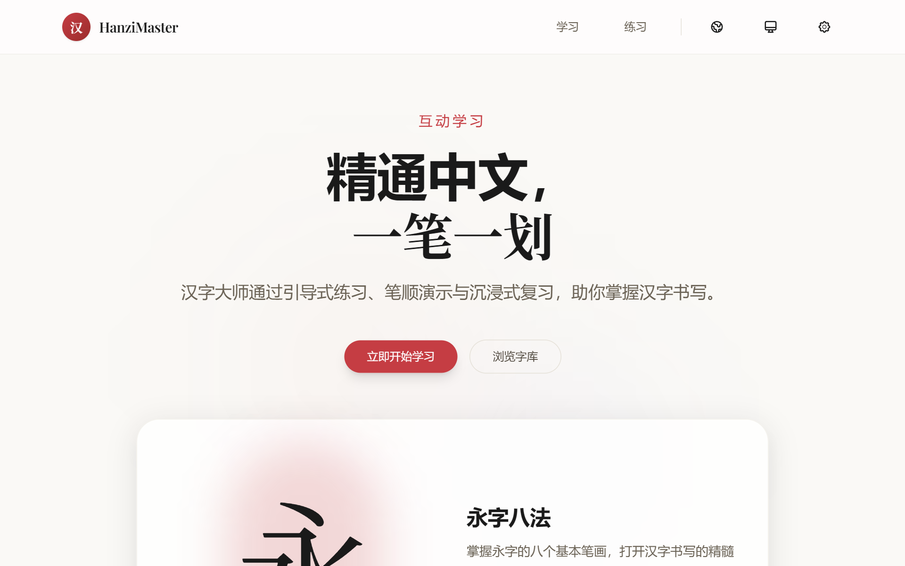
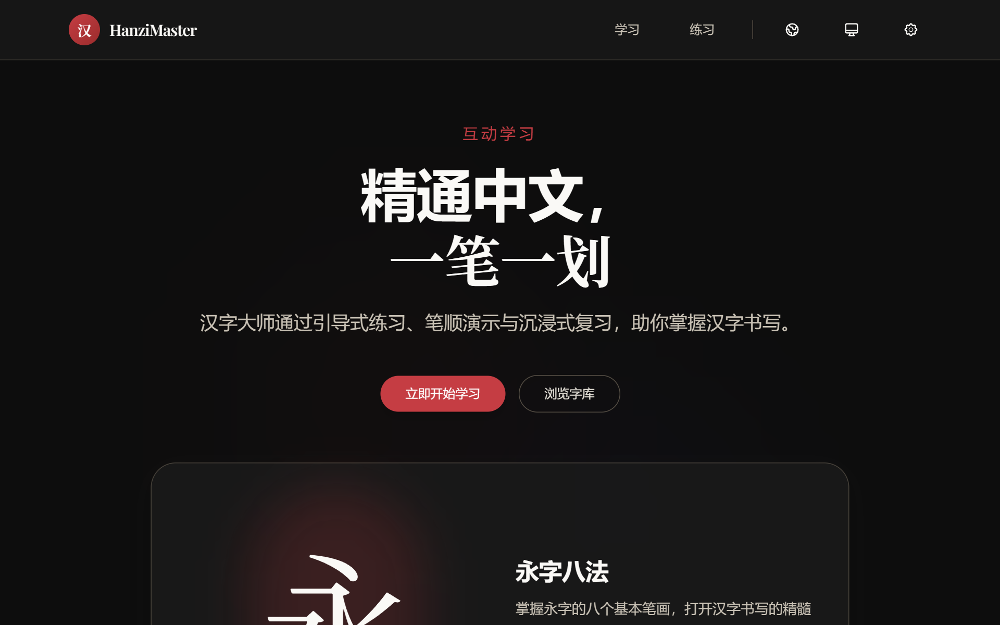
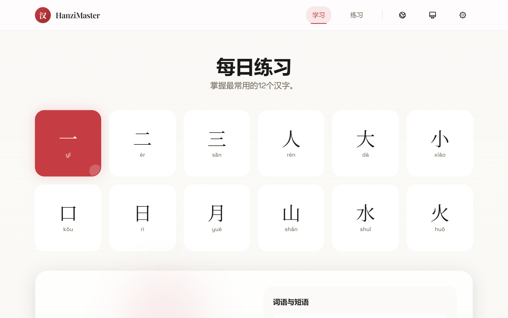
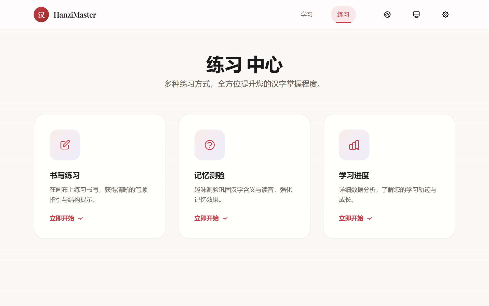

# HanziMaster 汉字大师 v5.2.45

[English](README_EN.md) | [简体中文](README.md)

[](https://github.com/Tanox/HanziMaster/actions/workflows/ci.yml)
[](LICENSE)


[](CONTRIBUTING_EN.md)

HanziMaster is a Chinese character learning app that helps you master handwriting through guided practice, stroke-order demonstrations, and immersive review. It is purely client-side and local-first: progress is stored in browser localStorage, with no accounts and no backend API.

## Preview

| Home (light / dark) | Learn · Practice |
| --- | --- |
|   |   |

## Features

- **Stroke & Structure Feedback** — clear stroke-order guidance and structure hints.
- **Multiple Learning Modes** — basic learning, handwriting practice, pinyin quizzes, progress tracking.
- **Tian-zi-ge Writing Practice** — Canvas handwriting with mouse/touch/stylus support and pronunciation playback.
- **Pinyin Quiz** — 4-choice test with live correct/incorrect stats and accuracy analysis.
- **Personalized Progress** — persisted results; streak days, accuracy, and weekly activity charts.
- **11 Languages** — Simplified/Traditional Chinese, English, Japanese, Korean, Spanish, French, German, Portuguese, Arabic, Russian.
- **Dark Mode** — follow system or switch manually (light / dark / system).
- **Ink-and-Vermilion Design System** — ink / vermilion / indigo scales with two distinct token sources.
- **Mobile Friendly** — fully optimized for phones and tablets.

## Getting Started

### Prerequisites

| Tool | Requirement | Notes |
|------|-------------|-------|
| Node.js | `>= 24.11.0` | `.nvmrc` pins `24.11.0` |
| Package manager | pnpm `>= 11` | enforced (`preinstall: npx only-allow pnpm`, `.npmrc`) |
| Browser | Latest Chrome / Firefox / Safari / Edge | development and manual testing |

### Install & Run

```bash
git clone <repository-url>
cd HanziMaster
pnpm install
pnpm dev
```

Open `http://localhost:3000`. Production build:

```bash
pnpm build
pnpm start
```

### Common Scripts

| Command | Description |
|---------|-------------|
| `pnpm dev` | Dev server (HMR) |
| `pnpm build` | Production build |
| `pnpm start` | Production server (port 3000) |
| `pnpm lint` | ESLint (`eslint .`) |
| `pnpm lint:fix` | ESLint auto-fix |
| `pnpm test` | Unit tests (Vitest) |
| `pnpm test:watch` | Watch mode |
| `pnpm test:run` | Test wrapper (artifacts to `reports/`, forwards `--coverage`) |
| `pnpm check:lines` | Source line-count gate (≤ 200 lines) |
| `pnpm check:root` | Root cleanliness gate (no temp scripts/artifacts in repo root) |
| `pnpm bundle:check` | Bundle size budget gate |
| `pnpm e2e` | Playwright E2E tests (incl. axe accessibility assertions) |
| `pnpm e2e:ui` | E2E UI debug mode |
| `pnpm i18n:lint` | 11-locale key parity check |
| `pnpm version:check` | Verify global version display consistency (used by CI) |
| `pnpm format` | Prettier formatting |
| `pnpm security:audit` | Production dependency audit (`pnpm audit --prod --audit-level=high`) |
| `pnpm security:audit:dev` | Full audit (including dev chain) |

Type check: `pnpm exec tsc --noEmit`. If you hit `ERR_PNPM_IGNORED_BUILDS` locally, see [docs/coding-standards.md](docs/coding-standards.md) §11 for equivalent Node commands.

> pnpm is enforced: `npm install` / `yarn` are blocked by the `preinstall` hook; the repo only has `pnpm-lock.yaml`.

## Project Structure

```
src/
├── app/                     # App Router: page / learn / practice + privacy / terms
│   ├── error.tsx / loading.tsx / not-found.tsx / global-error.tsx
│   ├── api/health/route.ts  # Health check endpoint
│   ├── manifest.ts / robots.ts / sitemap.ts
│   ├── globals.css          # Semantic design tokens (@theme)
│   └── styles/              # utilities.css / keyframes.css / rtl.css
├── components/              # ui/ learn/ practice/ state/ + shared components
│   ├── ui/                  # button / badge / dialog / tooltip
│   ├── learn/ · practice/   # Page-specific components
│   └── state/               # EmptyState / ErrorState / LoadingSpinner
├── hooks/                   # use-progress / use-pronunciation / use-haptic …
├── content/                 # Legal copy (EN / zh, sectioned)
└── lib/                     # characters / storage / utils / version / progress-utils
    ├── i18n/                # index + translate + 11 language packs + extensions/
    └── __tests__/           # Pure logic unit tests

e2e/                         # Playwright E2E tests (home / a11y)
prototype/                   # 6 HTML skeletons + styles/ + scripts/ (all ≤200 lines)
docs/                        # 16 specification documents (entry: docs/index.md)
scripts/                     # 7 Node tool scripts (see docs/03-development.md §3)
reports/                     # Script artifacts (gitignored)
.github/workflows/           # ci.yml (quality gates) / deploy.yml (Vercel)
```

CSP and security headers are injected centrally by `next.config.mjs` `headers()`; there is no middleware. Full tree: [docs/01-overview.md](docs/01-overview.md) §6.

## Version & Build Identifier

`package.json` `version` is the single source of truth. `next.config.mjs` reads it at dev/build time and injects `NEXT_PUBLIC_APP_VERSION` plus a build-time `NEXT_PUBLIC_BUILD_ID` (`yymmddhhmm`); `src/lib/version.ts` exposes them. The footer (`#site-footer` / `#footer-version`) and mobile drawer (`#drawer-version`) show `vX.Y.Z · build yymmddhhmm`. All 11 `footer.copyright` translations use the `{{versionLabel}}` placeholder, so releases never require editing translation files. See [docs/03-development.md](docs/03-development.md) §4.

## Core Pages

| Page | Route | Description |
|------|-------|-------------|
| Home | `/` | Feature introduction, 永字八法 (Eight Principles of Yong) demo |
| Learn | `/learn` | 12 basic characters, pronunciation, stroke order, quiz, keyboard navigation |
| Practice | `/practice` | Handwriting practice, pinyin quiz, real progress statistics |
| Privacy Policy | `/privacy` | Data collection and processing |
| Terms of Service | `/terms` | Terms of use and disclaimer |
| Health check | `/api/health` | App status, version and build ID |

## Tech Stack

| Area | Technology |
|------|------------|
| Framework | Next.js `16.4.4` (App Router) + React `^19.1.0` |
| Language | TypeScript `^5.7.3` (strict) |
| Styling | Tailwind CSS `^4.0.12` + `@tailwindcss/postcss ^4.2.11` |
| Components | shadcn + on-demand `@radix-ui` subpackages (dialog / slot / tooltip), lucide-react icons |
| Error monitoring | Sentry (`@sentry/nextjs`, zero overhead without a DSN) |
| Fonts | Space Grotesk / Playfair Display / Noto Serif SC / JetBrains Mono (`next/font/google`) |
| i18n | Custom i18n Context, 11 languages, `TranslationKey` union type |
| Testing | Vitest `^3.2.4` + jsdom + Testing Library (24 unit test files) + Playwright E2E |
| Deployment | Vercel / Tencent Cloud EdgeOne Pages |

## Development Standards

The following documents are the single authorities; this page does not redefine their rules:

| Topic | Document |
|-------|----------|
| Documentation hub, terminology & formatting | [docs/index.md](docs/index.md) |
| Code style, naming, directory layout, i18n, design tokens, version sync, quality gates | [docs/coding-standards.md](docs/coding-standards.md) |
| Commit message format & types | [docs/commit-template.md](docs/commit-template.md) |
| Branches, PRs, code review, release | [docs/git-workflow.md](docs/git-workflow.md) |
| Development environment & commands | [docs/03-development.md](docs/03-development.md) |
| Testing conventions | [docs/06-testing.md](docs/06-testing.md) |
| Contribution entry point | [CONTRIBUTING.md](CONTRIBUTING.md) |
| Task backlog (single source) | [docs/tasks.md](docs/tasks.md) |

Commits follow Conventional Commits: `<type>: <description>` with `feat` / `fix` / `docs` / `style` / `refactor` / `perf` / `test` / `build` / `ci` / `chore`. Every change bumps at least a patch version.

## Supported Languages

简体中文 · 繁體中文 · English · 日本語 · 한국어 · Español · Français · Deutsch · Português · العربية · Русский

## Deployment

Core pages need **no environment variables**; optional ones (site URL / GA / Sentry / bundle analysis) are documented in [.env.example](.env.example). `vercel.json` / `edgeone.json` only configure static asset caching and the EdgeOne build command. Vercel uses its default Next.js flow; EdgeOne builds with `pnpm build` (the platform config file says `npm run build`, which is a platform-internal command) and outputs `.next`. Pre-deploy checklist: [docs/05-deployment.md](docs/05-deployment.md) §7.

> `next/font/google` is the only network dependency at build time; offline builds may fail on font download (environment limitation, not a code defect).

## Accuracy and Disclaimer

Character data, pinyin, examples, stroke-order animations and structure hints are teaching aids maintained by this project. They may simplify or differ across conventions; for teaching, publishing or exam preparation, verify against authoritative dictionaries and standards. Pronunciation relies on browser built-in speech synthesis and varies by device and language. The app is provided "as is" without warranties to the extent permitted by law. See the deployed `/terms` and `/privacy` pages.

## License and Third-Party Notices

Released under the [MIT License](LICENSE); third-party dependency licenses are listed in [NOTICE](NOTICE). Contribution and security guidelines: [CONTRIBUTING.md](CONTRIBUTING.md), [CODE_OF_CONDUCT.md](.github/CODE_OF_CONDUCT.md), [SECURITY.md](.github/SECURITY.md), [SUPPORT.md](.github/SUPPORT.md), [PR template](.github/PULL_REQUEST_TEMPLATE.md).

© 2026 HanziMaster 汉字大师 v5.2.45
